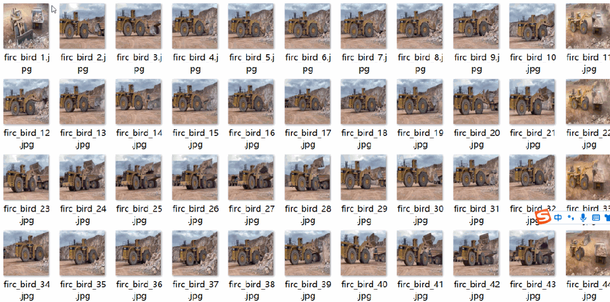
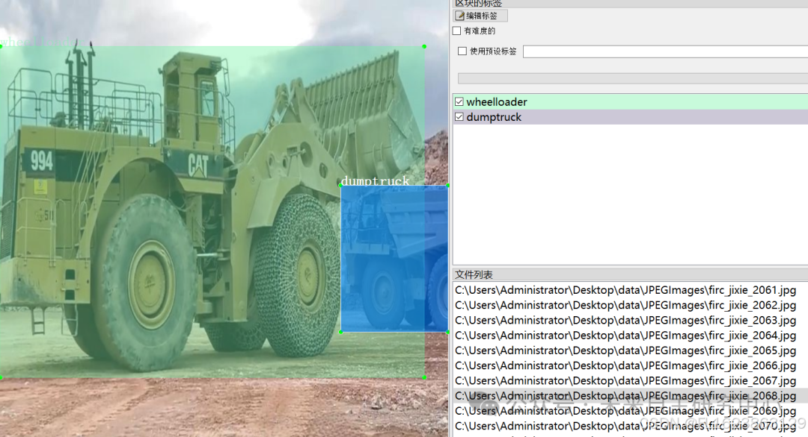

# Construction Machinery and Equipment - Self-Loading Crane WheeledLoader Test Dataset VOC+YOLO Format with 2644 Images in 3 Categories

Dataset format: Pascal VOC format + YOLO format (txt files without split paths, only containing jpg images and corresponding VOC format xml files and yolo format txt files)
Number of images (number of jpg files): 2644
Number of annotations (number of xml files): 2644
Number of annotations (number of txt files): 2644
Number of annotation categories: 3
Annotation category names: ["digger", "dumptruck", "wheelloader"]
Number of bounding boxes for each category:
- digger bounding boxes = 1530
- dumptruck bounding boxes = 1274
- wheelloader bounding boxes = 1080
Total number of bounding boxes: 3884
Labeling tool used: labelImg
Annotation rules: Draw a rectangle around the category
Important note: No guarantee is made regarding the accuracy or weights of the trained models. The dataset provides accurate and reasonable annotations only.

Image Preview:

Annotation example:

Download link:

## Payment

Here is a pay link on Stripe ( https://buy.stripe.com/3cs8yP7sY87d0vu9AB ). Please contact me lonlonago@foxmail.com after funding $89, and I will send you a complete data files , thank you!

